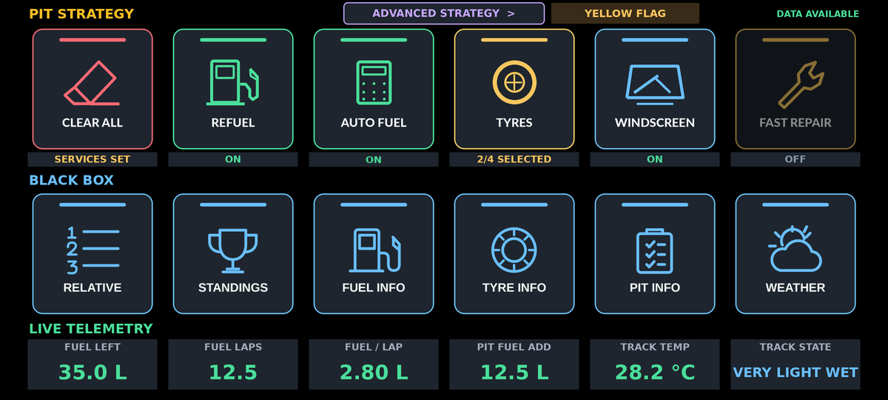
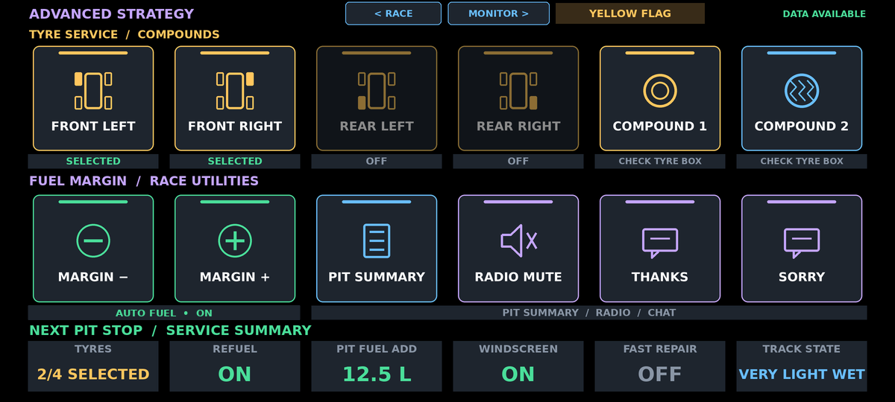
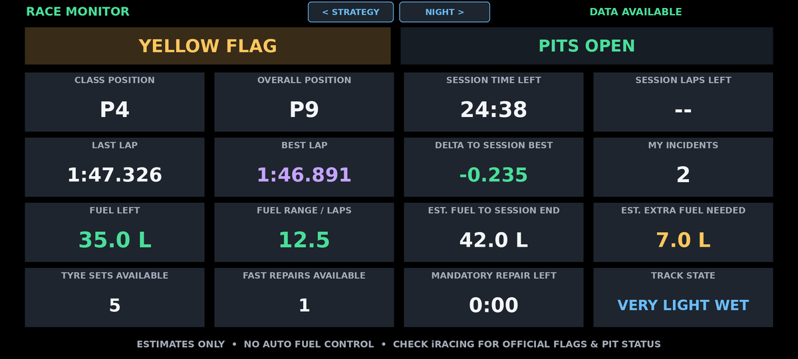
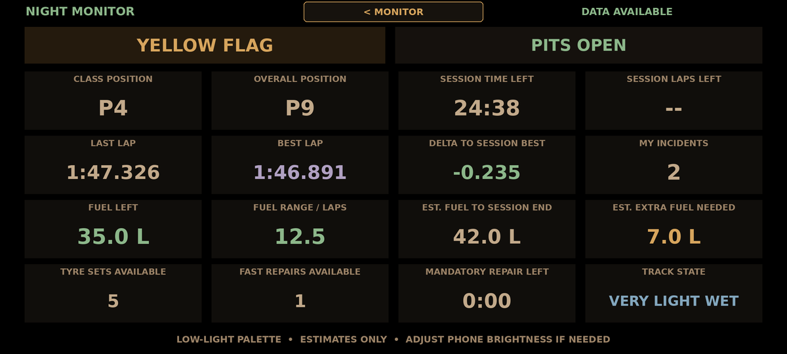

# iRacing Button Box for SimHub

**Free touchscreen button box for iRacing · v2.0.1**

 · [English](#english) · [Español](#español) · [Changelog](CHANGELOG.md)

[**Download ZIP / Descargar ZIP**](https://github.com/SergiBaucells/iRacing-Button-Box-SimHub/releases/download/v2.0.1/Botonera_iRacing_v2.0.1_Comunidad.zip)

## English

Turn your existing phone or tablet into a dedicated touchscreen button box for iRacing using SimHub. No specific steering wheel or additional button-box hardware is required.

### Features

- 24 iRacing control actions across four interactive screens.
- Pit services, individual tyre selection, compounds and Auto Fuel margin adjustments.
- Native Auto Fuel status: ON, OFF, N/A, or `--` when data is missing.
- Black Box shortcuts, quick messages and radio mute.
- Live race telemetry, flags, fuel warnings and track conditions.
- Landscape 2400 × 1080 (20:9) layout.
- Optional PowerShell utility to synchronize keyboard bindings across compatible iRacing control profiles.

### Installation

1. Install [SimHub](https://www.simhubdash.com/) on the Windows PC running iRacing.
2. Download the community ZIP from [Releases](https://github.com/SergiBaucells/iRacing-Button-Box-SimHub/releases/latest) and extract it.
3. Import the `.simhubdash` file into SimHub.
4. In **Devices**, add a **Web device slot**, select the dashboard and enable landscape orientation.
5. Open the dashboard URL or QR code on your mobile device connected to the same local network.
6. Configure the 14 Quick Text Chat macros and remaining key bindings as described in the included PDF manual (available in English and Spanish). Test the buttons in a safe practice or AI session before racing.

The dashboard is free of charge. iRacing and its subscription are not included. SimHub's free edition may limit refresh rates. Other aspect ratios may show black bars.

## Español

Convierte tu móvil o tablet en una botonera táctil para iRacing mediante SimHub, sin comprar hardware adicional ni necesitar un volante específico.

### Características

- 24 acciones de iRacing y cuatro pantallas interactivas.
- Gestión de boxes, selección individual de neumáticos, compuestos y margen de Auto Fuel.
- Estado nativo de Auto Fuel: ON, OFF, N/A o `--` si faltan datos.
- Accesos directos a Black Boxes, mensajes rápidos y silencio de radio.
- Telemetría de carrera, banderas, alertas de combustible y estado del asfalto.
- Diseño horizontal de 2400 × 1080 (20:9).
- Sincronizador opcional de asignaciones mediante PowerShell.

### Instalación

1. Instala [SimHub](https://www.simhubdash.com/) en el PC Windows donde ejecutas iRacing.
2. Descarga el ZIP de la comunidad desde [Releases](https://github.com/SergiBaucells/iRacing-Button-Box-SimHub/releases/latest) y descomprímelo.
3. Importa el archivo `.simhubdash` en SimHub.
4. En **Devices**, añade un **Web device slot**, selecciona la botonera y activa la orientación horizontal.
5. Abre la URL o el código QR desde el móvil o tablet conectado a la misma red local.
6. Configura las 14 macros de Quick Text Chat y las demás teclas siguiendo el manual PDF incluido. Prueba los controles antes de competir.

La botonera es gratuita. No incluye la suscripción de iRacing. La edición gratuita de SimHub puede limitar la frecuencia de actualización. Otras relaciones de aspecto pueden mostrar franjas negras.

## Screens / Pantallas

### 01 — Race Control
Pit services, Black Boxes and live telemetry / Servicios de boxes, Black Boxes y telemetría.

### 02 — Advanced Strategy
Tyre selection, fuel margin and communications / Neumáticos, margen de combustible y comunicación.

### 03 — Race Monitor
Race timing, position, flags, incidents and fuel estimates / Tiempos, posición, banderas, incidentes y estimaciones de combustible.

### 04 — Night Monitor
Low-luminance colour palette / Paleta de colores menos luminosa.

*Previews use simulated telemetry / Capturas con telemetría simulada.*

## Known limitations / Limitaciones conocidas

- Auto Fuel depends on session availability and sufficient fuel data. / Auto Fuel depende de la sesión y de los datos de consumo disponibles.
- Fuel estimates are advisory; verify in iRacing before a pit stop. / Comprueba las estimaciones en iRacing antes de repostar.
- Tyre compounds and fast repairs depend on the car and session rules. / Los compuestos y reparaciones dependen del coche y la sesión.
- Night Monitor changes colours, not physical screen brightness. / El monitor nocturno cambia los colores, no el brillo físico.
- The optional synchronization script requires your own reference profile, compatible binary formats and backups. Its community adaptation has not been tested on Windows. Always review the dry run first. / El script opcional requiere un perfil de referencia propio, formatos compatibles y copias de seguridad. Su adaptación comunitaria no se ha probado en Windows: revisa primero la simulación.
- Tested on the creator's setup; compatibility with all devices and future versions is not guaranteed. / Probado en el equipo del autor, sin garantía de compatibilidad universal.

## Support / Soporte

Report bugs or suggestions in [GitHub Issues](https://github.com/SergiBaucells/iRacing-Button-Box-SimHub/issues). Include dashboard and SimHub versions, car, session type and steps to reproduce. Do not share personal calibration files or device identifiers.

Comunica errores o sugerencias mediante Issues. Indica las versiones, el coche, el tipo de sesión y los pasos para reproducir el problema. No compartas archivos personales de calibración ni identificadores de dispositivos.

Independent community project, not affiliated with iRacing or SimHub. / Proyecto independiente, no oficial.
